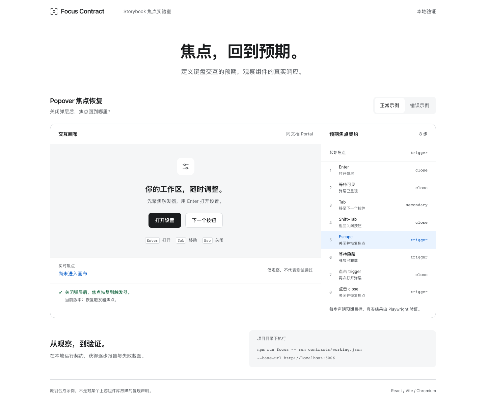

# Storybook Focus Contract

把“操作后焦点应该在哪里”写成契约，用真实 Chromium 验证，并导出能在项目中重跑的 Playwright 测试。

组件能打开弹层，不代表关闭后焦点会回到正确位置。这个工具让作者先写明预期，再执行 Tab、Shift+Tab、Enter、Escape 或点击，比较预期与实际焦点。遇到第一个偏差就停止，保留步骤、实际焦点和失败截图，便于在组件 PR 中讨论。

这是**手写契约的本地 CLI**。当前没有契约编辑面板或自动录制功能；自带 Storybook 工作台用于手动体验与焦点观察。它适合已有 Storybook、愿意维护稳定 `data-testid` 的组件库作者；无须账号、服务器或模型 API。

## 在线体验与源码

- [在线体验：正常示例](https://fightjs.github.io/storybook-focus-contract/iframe.html?id=demo-popover--working&viewMode=story)
- [在线体验：故意遗漏焦点恢复的示例](https://fightjs.github.io/storybook-focus-contract/iframe.html?id=demo-popover--broken&viewMode=story)
- [GitHub 源码与问题反馈](https://github.com/FightJs/storybook-focus-contract)

在线页面是静态 Storybook 演示，可以手动操作和观察焦点；真实 Playwright 自动断言和报告生成需要在本地运行 CLI。没有将页面内的焦点观察标记为测试通过。

## 用 STAR 理解它的作用

以本项目**原创合成的 Popover 案例**为例：

- **S（情境）**：组件作者在 Storybook 中展示弹层。弹层可以正常打开和关闭，但仅看界面无法确定键盘操作后的焦点位置。
- **T（任务）**：明确约定用 Escape 关闭后，焦点应回到打开弹层的触发按钮；同时让其他维护者可以复验这条约定。
- **A（行动）**：作者给元素添加唯一 `data-testid`，在 JSON 中写下按键与预期焦点，运行 CLI。工具在 Chromium 中发送真实键盘输入，用 Playwright 逐步断言；也可以导出可重跑的测试包。
- **R（结果）**：在已验证的合成对照中，正常版本的 8 步通过；故意遗漏恢复逻辑的版本在第 5 步报告预期 `trigger`、实际 `body`，并保存截图。结果只证明这两份示例在记录的环境和路径下的行为，不代表全面的无障碍审计。

[查看正常报告](docs/evidence/working/report.md) · [查看失败报告](docs/evidence/broken/report.md) · [查看验收记录](docs/VERIFICATION.md)

## 先跑一个正常与错误对照

需要 **Node.js 22.12+**、npm，以及首次安装依赖与 Chromium 时的网络连接。已验证版本见[验收记录](docs/VERIFICATION.md)。

在终端克隆仓库并进入项目目录：

```sh
git clone https://github.com/FightJs/storybook-focus-contract.git
cd storybook-focus-contract
```

安装并启动：

```sh
npm ci
npx playwright install chromium --only-shell
npm run build
npm run storybook
```

保持 Storybook 服务运行；默认地址是 [http://localhost:6006](http://localhost:6006)。在另一个终端进入同一目录：

```sh
npm run focus -- validate contracts/working.json
npm run focus -- run contracts/working.json --base-url http://localhost:6006
npm run focus -- run contracts/broken.json --base-url http://localhost:6006
```

正常版本应通过全部 8 步；错误版本**预期以退出码 1 失败**，在第 5 步 Escape 后发现焦点落在 `body`，而契约要求 `trigger`。两份契约的操作相同，只切换 story ID。

真实 CLI 报告：[正常结果](docs/evidence/working/report.md) · [第 5 步失败结果](docs/evidence/broken/report.md)。



界面已按浅色与灰阶重做，支持手机、平板和桌面。工作台可查看八步期望契约与当前实际焦点；实时观察不等于测试通过。独立多维评分和返修记录见[界面审查](docs/UI-REVIEW.md)。

这两个 Popover 都是本项目原创的合成示例。错误版本故意省略关闭后的焦点恢复，不代表任何上游组件库当前存在相同故障。示例使用同文档 portal，没有自造 Tab 顺序算法，也不声称是完整可访问弹层实现。

## 写一份契约

```json
{
  "version": 1,
  "storyId": "demo-popover--working",
  "initialFocus": "trigger",
  "steps": [
    { "action": "press", "key": "Enter", "expectFocus": "close" },
    { "action": "wait", "target": "panel", "state": "visible" },
    { "action": "press", "key": "Tab", "expectFocus": "secondary" },
    { "action": "press", "key": "Shift+Tab", "expectFocus": "close" },
    { "action": "press", "key": "Escape", "expectFocus": "trigger" },
    { "action": "wait", "target": "panel", "state": "hidden" }
  ]
}
```

- `storyId`：从 Storybook URL 的 `id` 或 `path=/story/...` 取得，例如 `demo-popover--working`。
- `initialFocus`：可选；仅在测试开始时把焦点放到指定元素，作为约定起点。后续步骤不会直接设置焦点。
- `steps`：1–20 步。点击和按键必须填写 `expectFocus`；显式等待可选填。
- 目标值对应元素的 `data-testid`，不是 CSS 选择器。例如 `<button data-testid="trigger">`。

| 操作 | 必填字段 | 行为 |
| --- | --- | --- |
| `click` | `target`, `expectFocus` | 真实点击后验证焦点 |
| `press` | `key`, `expectFocus` | key 仅支持 `Tab`、`Shift+Tab`、`Enter`、`Escape` |
| `wait` | `target`, `state` | state 为 `visible` 或 `hidden`；可附带 `expectFocus` |

目标必须有唯一 `data-testid`；可见等待、点击和预期焦点目标缺失或重复都会失败。`hidden` 等待允许目标已经卸载，或唯一目标不可见；重复目标仍然失败。不要用任意固定睡眠替代组件状态等待。

格式版本仅支持 `1`。未知字段、非法按键、空 ID、控制字符、超过 200 字符的 ID 和超限步骤均拒绝。完整边界见 [SPEC](SPEC.md)。

## 接入自己的 Storybook

1. 为要点击、等待和验证焦点的元素添加稳定且唯一的 `data-testid`。
2. 写下真正希望成立的交互路径，不要把当前错误焦点轨迹当作正确答案。
3. 启动业务项目的 Storybook，使用本工具的 `run` 命令测试对应 story ID。

```sh
npm run focus -- run ./my-focus.contract.json --base-url http://localhost:6006
```

`--base-url` 是 Storybook 根目录，支持部署子路径，例如 `https://example.com/design-system/`。不要传 manager 的 `index.html`、`iframe.html` 或带 query 的地址。工具会生成：

```text
http://localhost:6006/iframe.html?id=demo-popover--working&viewMode=story
```

这样真实 Tab 导航不会受到 manager 面板的干扰。每次 CLI 使用全新浏览器上下文、1280×720 viewport，使用 story 自身的默认 args、decorators 与环境；首版不注入自定义 args、globals、登录 Cookie 或任意脚本。需要这些前置条件时，请在业务项目中准备专用 story。

已验证的组合是 React/Vite Storybook 10.6.7 与 Playwright 1.65.1 所带 Chromium。支持同文档 light DOM 与 portal；不承诺其他框架或 Storybook 版本兼容。

## 查看结果

每次 `run` 都创建一个独立的 `results/<时间>-<随机后缀>/` 目录，终端打印实际路径：

```text
report.json    机器可读的契约、版本、每步结果和观察到的焦点历史
report.md      首个偏差与 expected/actual 表格
failure.png    失败时尽力保存的页面截图
```

通过退出 `0`；契约、加载、目标、操作或焦点断言失败退出 `1`。`firstFailure` 从 `1` 开始，`0` 表示加载或初始焦点设置失败。失败后不继续执行余下步骤。浏览器未安装或启动失败会提示错误，并在运行目录记录 `launch-error.json`。

默认导航、定位、操作和断言分别限时 5 秒。遇到异步弹层，应写明可见/隐藏等待。失败截图无法生成时记录原因，不会虚构图片。actual 包含元素的 tag、data-testid、id 与 role；焦点历史最多保存 200 次观察。

## 导出可重跑的测试

在已构建的工具目录执行，目标目录必须尚不存在：

```sh
npm run focus -- export contracts/working.json --out exported/working
cd exported/working
npm install
npx playwright install chromium --only-shell
STORYBOOK_URL=http://localhost:6006 npm test
```

Windows PowerShell 使用 `$env:STORYBOOK_URL='http://localhost:6006'; npm test` 设置地址。

导出包包含：

```text
focus.contract.json       作者声明的契约
focus.spec.ts             调用执行器并断言结果的 Playwright 测试
runner.js / contract.js   与 CLI 相同的执行和校验逻辑
playwright.config.ts      Chromium、无重试、单 worker
package.json / README.md  固定 Playwright 版本与重跑说明
```

结果位于 `test-results/`，HTML 报告位于 `playwright-report/`。原始报告会附加到测试结果。导出包不引用本工具的绝对路径，首次独立安装会生成自己的 `package-lock.json`，建议一并保存。

**测试包不包含业务组件源码。** 重跑仍需要原项目和可访问的 Storybook 服务；不能只拿一张报告图就重建原场景。

## 它验证什么

运行器使用 Playwright 的 `keyboard.press` 和 `click`，通过 `toBeFocused` 验证焦点。除可选初始定位外，不在步骤间调用 `.focus()`，也不用 `dispatchEvent(new KeyboardEvent(...))` 模拟原生 Tab 导航。

它验证的是作者选择的有限路径及操作后的最终焦点：

- 不证明不存在短暂的焦点泄漏，也不保证作者的预期符合所有业务场景。
- 不替代 axe、完整 WCAG 审计、读屏或人工键盘测试。
- 不支持 shadow DOM、跨 frame、跨页面导航、多浏览器、复杂 roving 的全部键值或任意动画竞态。
- 目标定位使用整个文档；请避免 portal 和画布内出现重复 test ID。

工具没有上传功能。安装依赖、首次下载浏览器，以及被测试页面自身仍可能联网。错误信息和截图可能包含页面内容，分享前请自行检查。

## 本地开发与验证

```sh
npm ci
npx playwright install chromium --only-shell
npm run typecheck
npm test
npm run test:e2e
```

界面专项复验：保持 `npm run storybook` 运行，在另一个终端执行 `npm run verify:ui`。它检查 320/375/768/1280/1440/1920px、弹层边界、真实键盘操作、观察反馈和文字对比度，结果及截图在 `results/ui/`。

`npm test` 校验输入、URL 和 CLI 导出边界。`npm run test:e2e` 构建真实 Storybook，以 Chromium 检查键盘、portal、错误报告和正常/错误 story，并在临时目录分别独立安装、运行两份导出包，核对其结果与 CLI 一致；这一步需要访问 npm registry。

只构建演示页面：`npm run build-storybook`，产物在 `storybook-static/`。开发工具源码在 `src/`，示例在 `demo/`，契约在 `contracts/`，回归测试在 `tests/`。CLI 运行的是 `dist/`，修改 TypeScript 后需重新 `npm run build`。

欢迎通过 [GitHub Issues](https://github.com/FightJs/storybook-focus-contract/issues) 提交最小复现契约、预期焦点和实际报告；分享前请移除敏感材料。也欢迎提交包含复现与验证说明的 Pull Request。当前没有发布 npm 包，请从源码运行。

## 项目状态与许可证

产品定位见 [PRD](PRD.md)，输入输出规范见 [SPEC](SPEC.md)，发布准备见 [PROMOTION](PROMOTION.md)。本版本缩小了原研究的 addon 范围，五维评分待重新独立复核；没有采用或 Star 增长数据。

本项目采用 [MIT 许可证](LICENSE)。第三方依赖遵循各自许可证。
