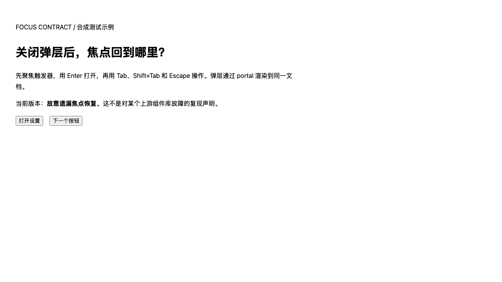

# Focus contract: failed

Story: demo-popover--broken

First failure: 5 (0 = setup)

| Step | Expected test ID | Actual | Status |
| --- | --- | --- | --- |
| 1 | close | button [data-testid="close"] | passed |
| 2 | close | button [data-testid="close"] | passed |
| 3 | secondary | button [data-testid="secondary"] | passed |
| 4 | close | button [data-testid="close"] | passed |
| 5 | trigger | body | failed |

Error:

```text
expect(locator).toBeFocused() failed

Locator:  getByTestId('trigger')
Expected: focused
Received: inactive
Timeout:  5000ms

Call log:
  - Expect "toBeFocused" getByTestId('trigger') with timeout 5000ms
  - waiting for getByTestId('trigger')
    14 × locator resolved to <button data-testid="trigger" aria-expanded="false" aria-haspopup="dialog">打开设置</button>
       - unexpected value "inactive"

```



Versions: {"tool":"0.1.0","node":"v22.23.1","playwright":"1.65.1","chromium":"159.0.8154.6"}

Only settled focus is asserted. This does not prove absence of transient focus leaks. Reproduction requires the original Storybook service and source. Screenshots may contain rendered page data.
